# PAC web admin — User Manual

A short, practical guide to managing your PAC (Proxy Auto-Configuration) files with the PAC web admin UI.

- [How it fits together](#how-it-fits-together)
- [Logging in](#logging-in)
- [Dashboard](#dashboard)
- [Quick add conditions](#quick-add-conditions)
- [PAC files](#pac-files)
- [Proxy rules](#proxy-rules)
- [Conditions](#conditions)
- [Proxies](#proxies)
- [Categories](#categories)
- [Pointing your browser at the PAC file](#pointing-your-browser-at-the-pac-file)
- [Typical workflow](#typical-workflow)

## How it fits together

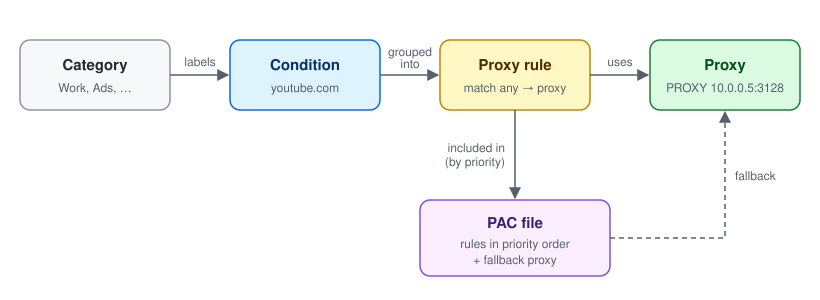

| Entity         | What it is                                                                 | Example                                 |
| -------------- | -------------------------------------------------------------------------- | --------------------------------------- |
| **Proxy**      | Where traffic goes                                                         | `PROXY 10.0.0.5:3128`, `DIRECT`         |
| **Condition**  | A test on the host or URL being requested                                  | host is `youtube.com` or its subdomains |
| **Category**   | A label for conditions, only for your convenience (does not affect output) | `Work`, `Streaming`, `Ads`              |
| **Proxy rule** | A set of conditions + one proxy. If **any** condition matches, that proxy is used | "Streaming via tunnel" → local tunnel proxy |
| **PAC**        | The generated file: rules in priority order + a fallback proxy             | `home.pac`                              |

## Logging in

Open the web admin in your browser (for example `http://your-server:5000/`) and sign in.

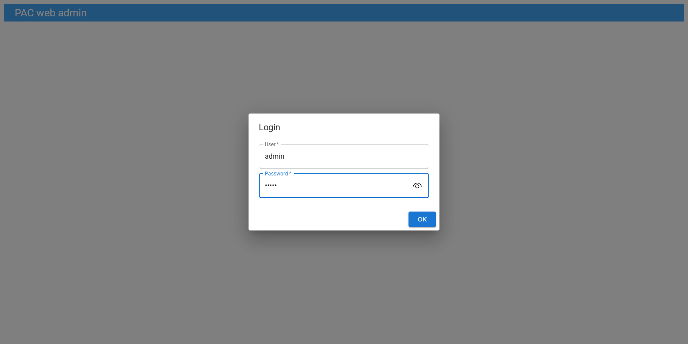

> If authentication is disabled on the server (`authEnable = false`), any user name and password are accepted.

The left sidebar gives access to every section: **Dashboard**, **PAC**, **Proxy rules**, **Conditions**, **Proxies** and **Categories**. Use **Logout** in the top-right corner when you are done.

## Dashboard

The dashboard lists all your PAC files. Click a PAC to expand it and see:

- whether it is **served** over HTTP and at which path,
- whether it is **saved** to disk and where,
- the **fallback proxy** (used when no rule matches),
- a live **preview** of the generated PAC JavaScript.

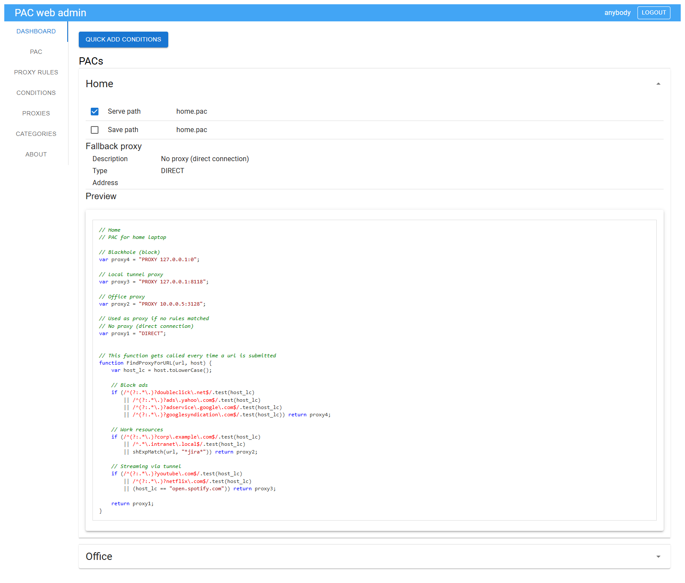

The preview is the quickest way to check that your rules produce what you expect.

## Quick add conditions

The fastest way to route new sites. Click **Quick add conditions** on the dashboard, then:

1. Choose a **Condition type** (e.g. *Domain or subdomain*).
2. Choose a **Category**.
3. Choose the **Proxy rule** the new conditions should be added to.
4. Paste the **expressions**, one per line.
5. Click **Add**.

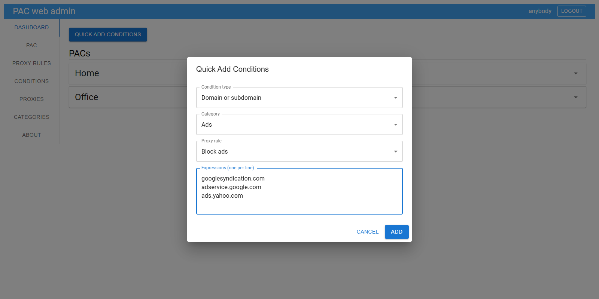

Conditions that already exist, or are already part of the selected rule, are skipped automatically.

## PAC files

The **PAC** section lists every PAC file. Use **Create new PAC** to add one, the ✏️ pencil to edit and the 🗑️ bin to delete.

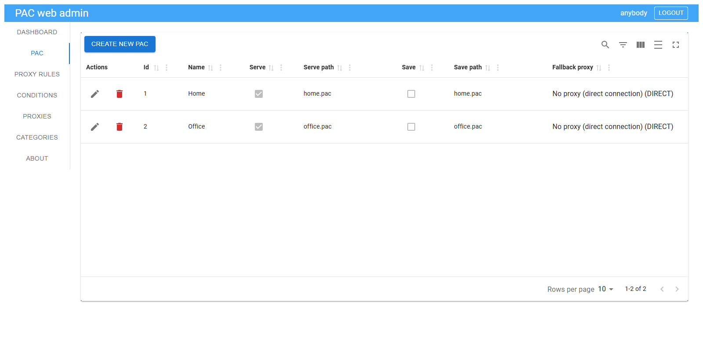

When creating or editing a PAC you set:

| Field              | Meaning                                                                    |
| ------------------ | -------------------------------------------------------------------------- |
| **Name**           | Human-readable name (also written as a comment in the file)                |
| **Serve**          | Make the PAC available over HTTP                                           |
| **Serve path**     | File name under the server's PAC URL, e.g. `home.pac`                      |
| **Save**           | Also write the generated file to disk                                      |
| **Save path**      | File name in the server's save directory                                   |
| **Fallback proxy** | Returned when no rule matches — usually `DIRECT`                           |
| **Proxy rules**    | Rules included in this PAC. Click **Add proxy rule** to pick them         |

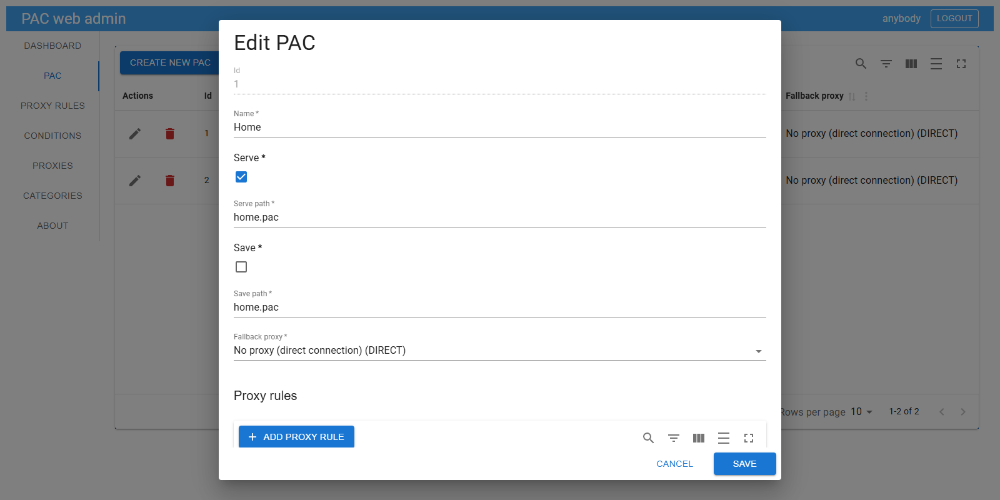

**Rule priority matters:** rules are checked in priority order and the first match wins. Edit the *priority* cell in the PAC's proxy rule list to reorder them — for example, put "Block ads" before the broader rules.

The same proxy rule can be shared by several PAC files, so you only maintain it in one place.

## Proxy rules

A proxy rule ties a group of conditions to one proxy.

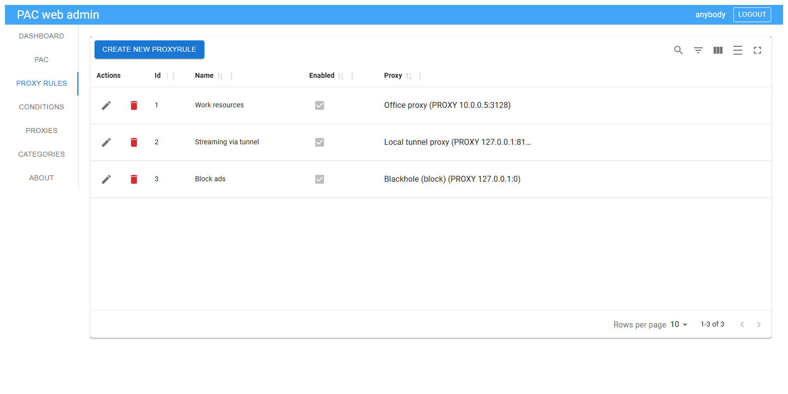

Click **Create new proxyrule** or the pencil icon to set:

- **Name** — shown as a comment in the generated file,
- **Enabled** — untick to temporarily exclude the rule from all PAC files,
- **Proxy** — where matching traffic is sent,
- **Conditions** — click **Add condition** to attach existing conditions, or the bin icon to detach one.

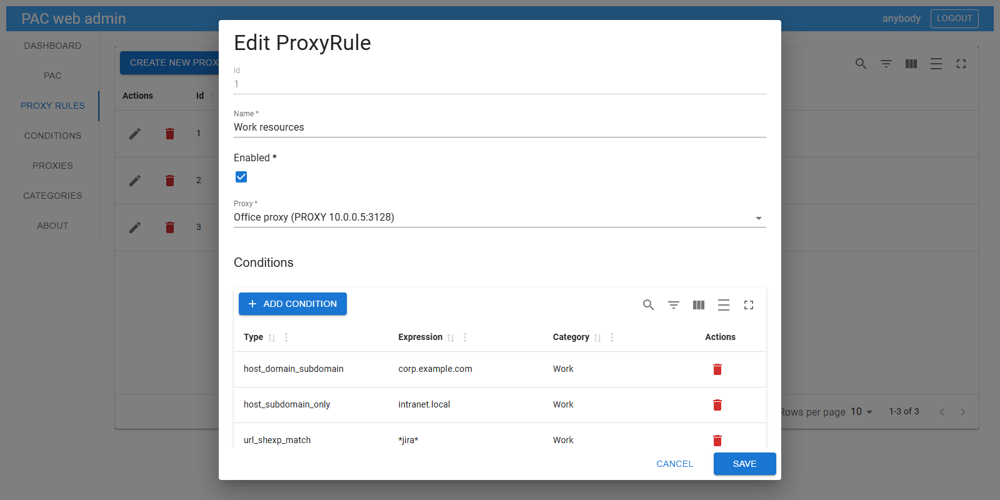

## Conditions

Conditions describe *which* requests a rule applies to.

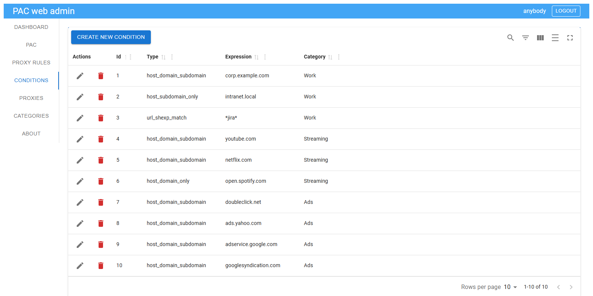

| Type                    | UI label               | Matches                                   | Example expression          |
| ----------------------- | ---------------------- | ----------------------------------------- | --------------------------- |
| `host_domain_only`      | Domain                 | exactly this host                         | `open.spotify.com`          |
| `host_domain_subdomain` | Domain or subdomain    | the domain and all its subdomains         | `youtube.com`               |
| `host_subdomain_only`   | Subdomain only         | subdomains only, not the domain itself    | `intranet.local`            |
| `url_shexp_match`       | URL shell expression   | full URL against a `*`/`?` wildcard       | `*jira*`                    |
| `url_regexp_match`      | URL regular expression | full URL against a regular expression     | `^https://.*\.internal/.*`  |

Use the search and filter icons in the toolbar to find conditions quickly in long lists.

## Proxies

Define every destination your rules can point to.

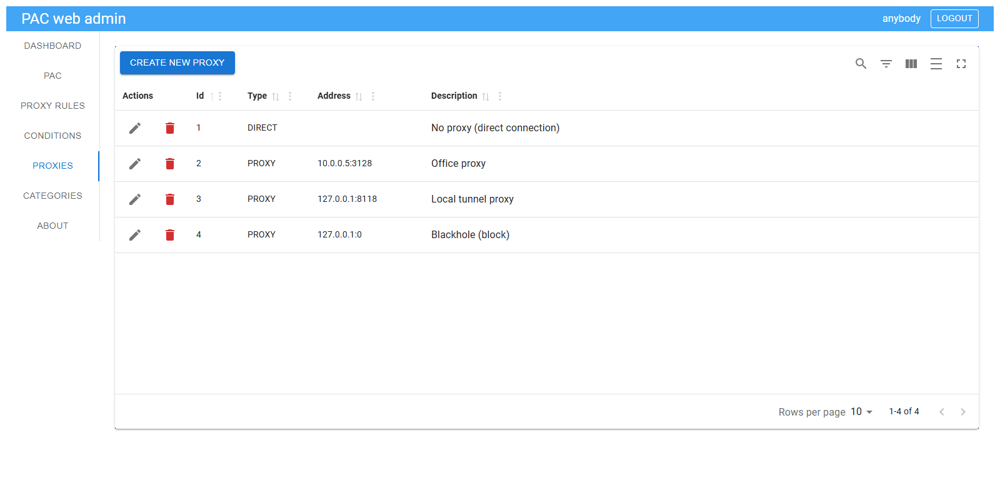

Use one of two types:

- `DIRECT` — no proxy (address not needed),
- `PROXY` — an HTTP proxy at `host:port`, e.g. `10.0.0.5:3128`.

> **Note:** the UI also offers `HTTP`, `HTTPS`, `SOCKS`, `SOCKS4` and `SOCKS5`, but Windows (WinHTTP/WinINet, and therefore Edge and Chrome on Windows) only understands `DIRECT` and `PROXY` in PAC files. Stick to these two unless every client is known to support the others.

> **Tip:** to *block* sites, create a proxy pointing at an unreachable address (e.g. `PROXY 127.0.0.1:0`) and use it in a "Block" rule.

## Categories

Categories are simple labels that keep your conditions organised (e.g. *Work*, *Streaming*, *Ads*). They are used for filtering in the UI only and do not change the generated PAC file.

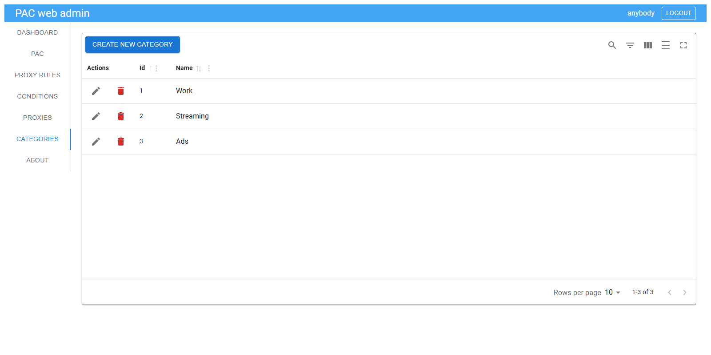

## Pointing your browser at the PAC file

A PAC with **Serve** enabled is available at:

```
http://your-server:port/pac/<serve path>
```

For example `http://your-server:5000/pac/home.pac`. Enter this URL as the *automatic proxy configuration script* in your OS or browser settings (Windows: *Settings → Network & internet → Proxy → Use setup script*; macOS: *Network → Details → Proxies → Automatic proxy configuration*; Firefox: *Settings → Network Settings → Automatic proxy configuration URL*).

The server sends `ETag` / `Last-Modified` headers, so clients re-download the file only when it changes.

## Typical workflow

1. **Proxies** — add your proxies (and a `DIRECT` one for the fallback).
2. **Categories** — create a few labels.
3. **Proxy rules** — create a rule per destination, e.g. "Work resources" → office proxy.
4. **Conditions** — add sites to the rules, most easily via **Quick add conditions** on the dashboard.
5. **PAC** — create a PAC, add rules, set priorities and the fallback proxy, enable **Serve**.
6. **Dashboard** — check the preview, then point your browser at the PAC URL.
